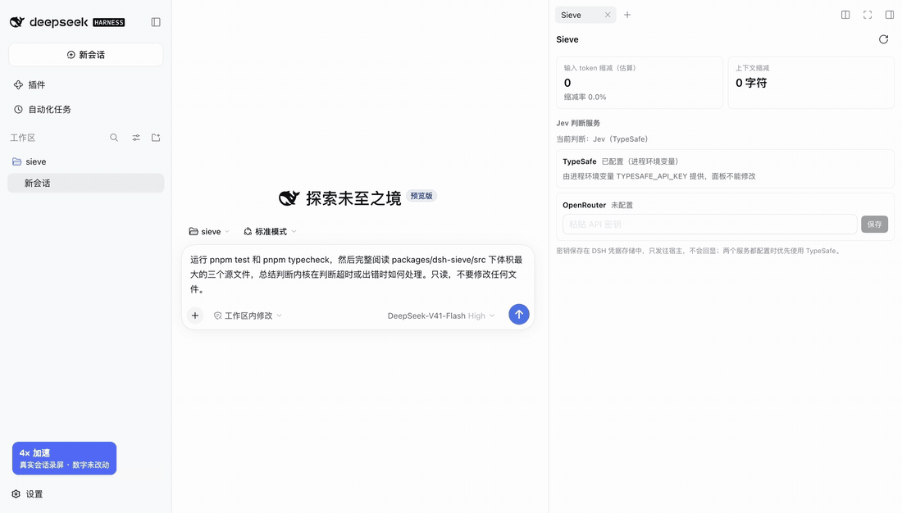
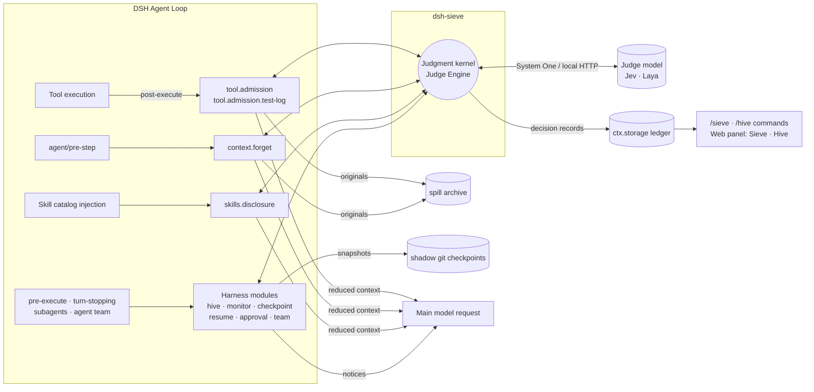
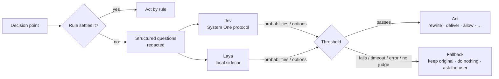

<div align="center">


<p><strong>English</strong> | <a href="README.zh-CN.md">简体中文</a></p>

<h1>sieve / dsh-sieve</h1>

**Your agent navigates countless decisions across long loops, yet most tokens pay for dead logs and stale history.<br>sieve is a precision mesh inside the execution loop: cutting through context inflation and delivering only the critical context that decides the next step.**

Context engineering, token efficiency and long-task supervision plugins for DeepSeek Harness (DSH)

[](LICENSE)
[](tsconfig.base.json)
[](package.json)
[](packages/dsh-sieve/package.json)
[](packages/dsh-sieve/package.json)
<br>


[](#design-constraints)
[](#design-constraints)

**−36%** request payload (offline replay, 100 trajectories) · **−21%** main model input tokens (live model, 80 runs) · **~0.3 s** per judgment · **0** DSH core patches

<sub>How each number was measured, and what it does not show: [offline replay](#offline-replay-results) · [live model results](#live-model-results-deepseek-flash). The live runs predate the current Jev / Laya setup.</sub>

</div>

<p align="center"></p>
<p align="center"><sub>A real session in DSH Web: while the agent reads code and runs tests, the <b>Sieve</b> page on the right counts up the estimated input token reduction and the characters taken out of the context.</sub></p>

sieve is a high-performance DSH plugin that filters tool output, forgets stale context, and discloses skills strictly on demand. Every raw output is archived before rewriting and remains one `read` away. Powered by the same judge engine, a suite of harness modules supervises long tasks to eliminate false completions and infinite loops.

> [!IMPORTANT]
> sieve needs a judge model: **Jev** (hosted, needs an API key) or **Laya** (local, macOS on Apple Silicon). It never borrows the session's own model. Without one, the token-saving decisions change nothing and the harness modules run on their rules alone. [Set one up](#judge-models-jev--laya).

## Why sieve

Your agent navigates hundreds of critical decisions across complex tool-calling loops.

Yet one glance at its real context ledger reveals a grim reality: actual user prompts and core code represent only a tiny fraction of the payload. The overwhelming bulk is pure context inflation:

- **The tool output tsunami**: A test runner spews 8,000 characters. The model only needs the single failing assertion, yet repeatedly pays for 200+ lines of passing tests on every subsequent turn.
- **Ghostly stale history**: A file read thirty steps ago—long since superseded—rides along as a ghost passenger in every request.
- **Bloated skill catalogs**: Hundreds of skill descriptions loaded at session start when 97% are never touched, permanently diluting the model's attention.

This is not pocket change—it is a critical signal-to-noise crisis.

Input tokens snowball quadratically with every turn. As the context window chokes on dead logs, the model's attention dilutes, hallucinations increase, and tasks stall out.

**sieve is the precision mesh built for this storm.**

No blunt truncations. Zero patches to DSH core. Before tool results enter the session and before history piles into dead weight, sieve queries a lightweight judge model (~0.3 s) to prune the noise, archive the byte-exact original to disk, and hand the model only lean, high-signal context.

### What it looks like

A 263-line vitest run with one failure (8,020 characters), through sieve's test-log rules:

```diff
  RUN  v4.1.8 /work/app

- ✓ src/parser.spec.ts (18 tests) 82ms
-   ✓ parser handles case 1 1ms
-   … 223 more lines of passing tests …
+[sieve: omitted 225 lines: passing tests]
  ❯ src/date.spec.ts (8 tests | 1 failed) 61ms
    …
    × date > parses ISO week dates 4ms
  FAIL  src/date.spec.ts > date > parses ISO week dates
  AssertionError: expected '2026-W01-1' to be '2025-12-29'
    …
  Test Files  1 failed | 12 passed (13)
       Tests  1 failed | 222 passed (223)
+[sieve: full output: /var/folders/…/dsh-spill-…/session-…/…-bash.txt]
+Use read with offset/limit, or grep this path to search within it.
```

The model receives 1,138 characters instead of 8,020 (**an 86% reduction**).

- **Byte-exact preservation**: Kept lines match the original byte for byte; failure traces, diffs, and test summaries are strictly protected.
- **Zero data loss**: The full output is archived to spill disk first—one `read` away if the agent ever needs it.
- **Cache-friendly by design**: Pruning happens before the result enters the session, so prompt cache prefixes never see the bloated version.

### Why a dedicated judge model

- **The limit of static heuristics**: Regex and rule-based scripts choke on unfamiliar formats, forcing them to let bloated logs through untouched.
- **The cost of asking the main model**: Having the primary LLM decide what to discard wastes expensive tokens and burns an entire reasoning turn on routine cleanup.

**sieve's approach: a dedicated sidecar judge.**
It poses lightweight, structured yes/no or single-choice questions with calibrated probabilities in **~0.3 seconds** (median, offline replay).
If confidence falls below threshold—or if any error or timeout occurs—sieve triggers safe fallback: **the full original is kept untouched**.

### When tasks run deep: long-task supervision

When an agent runs for hours, saving tokens is no longer enough. The real killers become drift, illusions, and silent failures:
- Claiming "task complete" right after editing files without ever running the test suite;
- Rebounding from a mid-command crash without knowing if the broken call is safe to replay;
- Slamming into the exact same error three times in an endless loop;
- Running multi-agent swarms where worker bees duplicate effort in blind silos.

sieve's harness modules share the exact same judge engine: acting not just as a token tourniquet, but as an always-on supervisor and safety co-pilot for long-horizon execution.

## Core capabilities and use cases

For AI coding agents on DeepSeek Harness, especially with verbose test logs, frequent tool calls, long sessions or large skill catalogs.

| Area | How sieve handles it |
|---|---|
| **Input token reduction** | Filters redundant tool content before it enters the session, reducing input resent on later steps |
| **Tool output filtering** | Handles build logs, test reports and command output by category, protecting failure details and test summaries |
| **Context compaction / pruning** | Replaces irrelevant older tool results in batches, retaining archive pointers for on-demand retrieval |
| **Progressive skill disclosure** | Shows skills by task relevance, reducing context window usage from unrelated descriptions |
| **Prompt cache awareness** | Processes new results before they are recorded and batches historical pruning to control prefix rebuild frequency |

## What's new in 0.4.0: harness modules

> [!NOTE]
> **Released in 0.4.0.** Coming from 0.3.0, which has only the token-saving decisions? Run `dsh plugin --profile web add dsh-sieve@0.4.0 dsh-sieve-web@0.4.0` and restart `dsh web`; see [Upgrade and uninstall](#upgrade-and-uninstall).

Saving tokens was only the opening act. For deep, long-horizon tasks, sieve introduces six harness modules driven by the exact same judge engine to prevent drift, loops, and false completions:

| Module | In one line |
|---|---|
| **Hive** | Ask one question, get 2–6 read-only bees on it. They post findings to a shared board, and the judge decides which bee needs which finding |
| **Long-task monitoring** | Claims "done" after an edit nothing ran? Marks a goal complete the facts do not support? Fails the same way three times in a row? It notices |
| **Checkpoints and rewind** | A snapshot before each turn's first change; `/sieve rewind` puts the files back and forks the conversation from that turn |
| **Crash-resume** | Back from a crash in the middle of a command? The model is told whether that call is safe to run again |
| **Jev approval** | Routine calls run without asking you, calls sending credentials elsewhere are refused, and the rest still asks |
| **Team supervisor** | For DSH agent teams: frees stuck members, reopens tasks that do not hold up, holds edits inside another member's files |

Hive, checkpoints and crash-resume act by default. Monitoring and the team supervisor start in the new `shadow` mode, recording what they would have done until you switch them on; Jev approval is off until `approval.enabled`. Details in [Harness modules](#harness-modules).

Also new: `/sieve checkpoints`, `/sieve rewind`, `/sieve rewind undo` and `/hive` ([Session commands](#session-commands)); a **Hive** page beside the **Sieve** page in the Web panel, with each bee's state, a live delivery graph and the delivery stream; the `shadow` mode, 15 new decision ids and six config sections ([Configuration](#configuration)); and new DSH peers: `dsh-subagent`, `dsh-goal`, `dsh-permission-presets`, `dsh-sandbox-policy`, `dsh-user-approval`, plus `dsh-experimental-agent-team` as optional, all at `0.2.1-rc.2`.

<details>
<summary>Fixes in this update</summary>

- The ledger opens its storage asynchronously, and records made before it opened were dropped, so a session could lose its first records. They are now held in memory (up to 1,000) and written in order once storage is open.
- A hive that hits the host's sub-agent limit (`maxActiveSubagents`) no longer leaves a bee waiting forever. Bees turned away queue for a slot while the hive still has bees running or starting, and cancelling ends the wait.
- A team verifier now has a time limit (`team.verifierMinutes`, 10 minutes by default) and is stopped when sieve unloads.
- `/sieve rewind` checks that the conversation can be forked before it touches any file. If the fork still fails after the files are restored, the rewind is kept as a files-only rewind that `/sieve rewind undo` can reverse, and the session is told.
- After a restart, a resumed bee is still recognized as a bee, so a message sent to it does not bring back its write and spawning tools.

</details>

## Quick start

1. Install the plugin (the web profile also gets the panel):

   ```bash
   dsh plugin --profile web add dsh-sieve@0.4.0 dsh-sieve-web@0.4.0
   ```

2. Configure a judge model, one of:
   - **Jev**: paste a TypeSafe or OpenRouter API key on the **Sieve** page of the DSH Web sidebar, or set the `TYPESAFE_API_KEY` environment variable;
   - **Laya**: start the Laya server on this machine and set `judge.type` to `laya` in the profile, see [Using Laya](#using-laya).
3. Restart `dsh web` and reload the page, then enter `/sieve status` in a session and check that the "判断模型" (judge model) line does not say "未配置" (not configured).

That's it: work as usual and watch the **Sieve** page count up. Then try `/hive <a question about your code>` and keep the **Hive** page open. For other ways to install see [Installation](#installation).

## Architecture



| Component | Role |
|---|---|
| **Judgment kernel** | One decision engine: builds the questions, calls the judge model, validates the structured answers and decides by confidence threshold whether to act; a timeout or failure always takes the safe fallback |
| **`tool.admission`** | Admission control for tool results before they enter the session; handles long output in tiers and rewrites only `content`, never the tool call |
| **`tool.admission.test-log`** | A dedicated admission path for test runs that protects failures, summaries and anything it does not recognize |
| **`context.forget`** | Forgets older tool results in batches through DSH's native `compaction/prune` and result replacement; a batch is committed only when it saves enough, see the [cache FAQ](#faq) |
| **`skills.disclosure`** | Filters the first skill catalog by task relevance and announces skills that become relevant in later turns; hidden skills can still be loaded directly |
| **Harness modules** | Six sets of decisions that supervise long tasks, see [Harness modules](#harness-modules) |
| **Ledger** | One `ctx.storage` document per session with each judgment's result, usage and estimated saving |
| **`dsh-sieve-web`** | DSH Web right sidebar. The **Sieve** page shows the session's estimated input token reduction and context reduction in characters, the judge model in use, and Jev key configuration; the **Hive** page shows the session's hives |

## Harness modules

The same kernel also supervises long tasks. Each module is a set of decisions with its own default mode: `active` acts, `shadow` only writes to the ledger what it would have done, `off` does nothing.

| Module | Decisions | Default | What it does |
|---|---|---|---|
| **Hive** | `hive.*`, `swarm.routing` | active | The `hive` tool and `/hive <question>` put 2–6 read-only investigators ("bees") on one question. Bees post findings to a shared board; the judge passes each finding only to the bees it bears on, retracts superseded notes and sends a verifier bee to settle a contradiction. The result is every bee's report plus a board summary; the Web panel's Hive page draws the deliveries as a graph |
| **Long-task monitoring** | `goal.met`, `turn.completion`, `turn.drift` | shadow | Holds back `update_goal` from marking a goal complete when the facts say otherwise, reminds the model once per turn when it claims to be done after changing files without running anything, and notices loops, stalls and drift from the goal |
| **Checkpoints and rewind** | `turn.rewind` | active | Snapshots the workspace with a shadow git (never the project's own `.git`) before the first change of each turn. `/sieve rewind` restores the files in place and forks the conversation at that turn. When the agent keeps failing, the judge may suggest a rewind; it never performs one |
| **Crash-resume** | `resume.safety` | active | After a cold resume, classifies the tool call that was running when the session stopped (`read_only`, `idempotent`, `verify_first`, `unsafe`) and tells the model whether it may run it again, pointing to a checkpoint where one exists |
| **Jev approval** | `tool.approval`, `tool.risk` | off until `approval.enabled` | Takes over DSH's **Auto** permission preset. Reads and edits inside the project run; credentials sent to another machine are always refused; a command a risk rule flags runs only when the judge finds the user asked for it; any other call runs only on a sure "needed for the task". Everything else, and every judge failure, asks the user |
| **Team supervisor** | `team.release`, `team.verify`, `team.conflict`, `team.dispatch` | shadow | Loads only where DSH's agent team is installed, and acts as the Lead only to release, reassign and interrupt. It releases a member the monitor keeps finding stuck (after suggesting a hive once), reopens a completed task that does not hold up (a read-only verifier settles unclear cases), holds an edit inside another member's write scope, hands ready tasks to idle members, and after a crash wakes or releases owners that were cut off mid-command |

Boundaries:

- Write scopes are checked on the file-writing tools only; a member can still write through `bash`.
- Jev approval and DSH's `auto-review` plugin both provide the Auto preset, so only one of them can be loaded. When sieve unloads, sessions still on Auto go back to the default preset.
- Sub-agents are approved against the user's own request in the nearest non-sub-agent session; the brief a parent model wrote does not count.

### Field report: one real hive

2026-10-31, `dsh web`, three bees on `deepseek-flash`, Jev `jev-1.14.0` as judge. The question: how does the hive pick a finding's recipients, and what caps a bee's notes?

| Time | Notes on the board | Deliveries | Corrections | Judge calls | Judge cost | Main model |
|---:|---:|---:|---:|---:|---:|---:|
| 346 s | 19 | 15 | 2 | 195, none failed, median 248 ms | ≈ $0.018 | ≈ 4.69M tokens, 89% cache reads, ≈ $0.12 off-peak |

The answer named the right files, functions, lines and caps. Both corrections came from one bee: it posted that the code was not in the first directory it searched, then pointed the others to the right repository. The Hive page followed the run live, with each bee's state, the delivery graph and the delivery stream.

### Can a fooled judge let something bad through?

Jev approval was replayed offline on 35 labeled calls (15 should run, 16 should ask, 4 should be refused), drawn from an existing permission test suite and the risk tiers of `auto-review`, through the gate's own code with three stub judges. Short answer: a judge fooled into saying yes to everything does let 14 calls through that should have asked, but not one of the credential and DSH-settings calls, which the rules hold on their own:

| Stub judge | False allows | Asks saved (of 32) | Credential calls refused |
|---|---|---|---|
| Faithful | 0 | 12 | 4 of 4 |
| Fooled (always "needed, and asked for") | 14; the 6 credential and DSH-settings calls still held by rules | — | 4 of 4 |
| Never answers | 0 | 2 | 4 of 4 |

With the real judge (Jev `jev-1.14.0`, 2026-10-31, the same 35 calls three times over): no false allow in 105 calls; 11 of 32 asks saved in each round; all 4 credential calls refused; no judge failure, a median of 237 ms per judgment, and $0.0012 in judge cost for all three rounds. The one miss is on the safe side: the force-with-lease push the user asked for was put to the user, because Jev did not find it clearly requested.

## Judge models (Jev / Laya)

What rules can handle, deterministic rules handle. What they cannot settle goes to the judge model. A decision point turns the content into structured questions (yes/no, single choice); the judge model answers each with a probability or an option, and the kernel acts or takes the fallback by threshold.



| Judge model | Description | Needs |
|---|---|---|
| **Jev** | TypeSafe's structured judgment model. It answers yes/no and single-choice questions natively over the System One protocol, with a probability for each answer. Reached through TypeSafe's own endpoint or OpenRouter, billed by TypeSafe ([official pricing](https://docs.typesafe.ai/models)) | A TypeSafe or OpenRouter API key |
| **Laya** | An open-weight typed decision model (mmBERT-base, 322M) running on Core ML on this machine: requests never leave it and cost nothing. Its window is only 1024 tokens, so long states are cut, and it is clearly weaker than Jev on complex questions | macOS on Apple Silicon, with the local Laya server running |

**No session model.** Judgments go only to Jev or Laya. sieve never hands a judgment to the session's main model and has no setting for it; a profile from an older version with `judge.type: llm`, `judge.type: off`, `judge.provider` or `routes` fails to load.

**Without a judge model.** The default `judge.type: auto` looks for a Jev key before each decision. Without one, the four token-saving decisions do not run at all, rules included: nothing is folded, forgotten or filtered, and nothing is recorded; `/sieve status` and the web panel say no judge model is configured. The harness modules keep the parts rules settle and take the fallback wherever they would ask the judge (in `shadow`, both are only recorded):

- checkpoints are still taken and `/sieve rewind` works; no rewind is suggested;
- Jev approval, when enabled, still runs reads and edits inside the project, refuses credentials sent to another machine and asks about DSH's own folders; every other call asks the user;
- crash-resume still marks a read-only call as safe to run again and says nothing about the others;
- monitoring still catches loops and blocks a goal that keeps looping; the completion, goal and drift checks do nothing;
- a hive still runs, but no finding is posted, so the bees work as independent investigators;
- the team supervisor still releases members the monitor keeps finding stuck and holds an edit inside another member's write scope; it verifies and dispatches nothing.

A saved key takes effect from the next decision, without a restart.

**Judgments stay out of the conversation.** A judge call is a side request: it is not written to the session log, does not enter the main model's context and does not change the main model's request prefix. What goes to the judge is redacted first: only content that is certainly a credential is replaced, namely credential-shaped tokens, assignments whose names mark them as secrets, and the values of this process's credential variables.

**Failure takes the fallback.** Each judgment has a deadline (4000 ms by default); on a timeout, an error or an invalid answer the original is kept (or the module does nothing, or the user is asked) and the reason is recorded in the ledger.

### Using Jev

Provide a key in any of these ways:

- **Web panel**: the "Jev 判断服务" (Jev judge service) section of the **Sieve** sidebar page. Paste a TypeSafe or OpenRouter key and save it. The key is stored in `$DSH_HOME/.credentials.yaml`, sent only to the host, and never shown again. With both configured, TypeSafe is used.
- **Environment variables**: `TYPESAFE_API_KEY` or `SIEVE_JUDGE_OPENROUTER_API_KEY`, in the shell that starts `dsh`, a `.env` in the start directory, or `$DSH_HOME/.env`. Process environment variables take precedence over keys saved in the panel; the panel then shows only the source and cannot change it.
- **Profile**: `judge.type: system-one` with an `apiKey` (preferably `!!js process.env.XXX`) and optional `baseUrl` and `model`, see [Configuration](#configuration).

> [!NOTE]
> With the default `auto`, any `TYPESAFE_API_KEY` in the environment (an export in a shell profile, or a project `.env`) makes sieve call Jev and incur TypeSafe charges.

Measured in offline replay: 326 Jev requests, all successful; HTTP latency P50 287 ms, P95 590 ms.

### Using Laya

Laya runs on this machine and supports only macOS 15+ on Apple Silicon (Core ML). sieve only connects to a Laya server over local HTTP, by default at `127.0.0.1:47823`; it ships no server and does not install or start one. Setting one up takes three parts:

1. **Inference library**: [`laya-coreml`](https://github.com/mizorewww/laya-coreml) (Apache-2.0), a Core ML port of [Laya](https://github.com/NandhaKishorM/laya) that needs no PyTorch. With [uv](https://docs.astral.sh/uv/):

   ```bash
   uv venv --python 3.12 ~/.laya/.venv
   ```

   ```bash
   uv pip install --python ~/.laya/.venv/bin/python --index-url https://pypi.org/simple laya-coreml==0.1.0
   ```

2. **Weights**: the checkpoint `aac6fef/laya-multilingual-coreml` on Hugging Face (mmBERT-base, 322M, FP16, about 680 MB). Download it and check it against the bundle's own manifest:

   ```bash
   ~/.laya/.venv/bin/python - <<'PY'
   import json
   from pathlib import Path
   from huggingface_hub import snapshot_download
   from laya_coreml.artifacts import verify_files

   target = Path.home() / ".laya/models/laya-multilingual-coreml"
   snapshot_download("aac6fef/laya-multilingual-coreml", local_dir=target, allow_patterns=[
       "coreml_config.json", "rl_agent_config.json", "encoder/config.json", "tokenizer/*",
       "model.mlpackage/**", "host_weights.safetensors", "README.md", "LICENSE*", "NOTICE*"])
   files = json.loads((target / "coreml_config.json").read_text())["files"]
   verify_files(target, files)
   print(f"verified {len(files)} files")
   PY
   ```

   In Python, `laya_coreml.load(model_dir, local_files_only=True)` returns a model whose `predict(state, questions)` answers Laya's own question types (`noul`, `choice`, `score`).

3. **HTTP server**: a small local service around that model that implements the protocol below. sieve does not provide one; write your own or use any implementation of the same protocol.

<details>
<summary>Laya server protocol</summary>

`POST /evaluate`, `Content-Type: application/json`:

```json
{
  "state": "string, object or array",
  "questions": {
    "q1": { "type": "boolean", "instructions": "…", "criteria": { "true": "…", "false": "…" } },
    "q2": { "type": "choice", "instructions": "…", "criteria": { "keep": "…", "drop": null } },
    "q3": { "type": "score", "instructions": "…", "criteria": ["low", "mid", "high"] }
  }
}
```

`boolean` corresponds to Laya's `noul`; `criteria` of a `boolean` question is optional, and `null` descriptions should be passed to Laya as empty or left out. A successful response is HTTP 200:

```json
{
  "answers": {
    "q1": { "type": "boolean", "probability": 0.93 },
    "q2": { "type": "choice", "choice": "keep", "probabilities": { "keep": 0.81, "drop": 0.19 } },
    "q3": { "type": "score", "score": 1.4, "probabilities": { "0": 0.1, "1": 0.4, "2": 0.5 } }
  },
  "usage": { "inputTokens": 980, "outputTokens": 0 },
  "warnings": [{ "type": "state_truncated", "questionId": "q1", "message": "…" }],
  "providerMetadata": { "laya": { "model": "laya:aac6fef/laya-multilingual-coreml", "answers": { "q1": { "confidence": 0.7 } } } }
}
```

- Every question must get an answer of the same `type`, or sieve rejects the whole response. `probability` is P(true); `score` is a fractional position in `[0, levels - 1]`.
- `usage`, `warnings` and `providerMetadata` are optional. `warnings` is where truncation should be reported (sieve records it in the ledger); `providerMetadata.laya.model` names the model in the ledger, and `confidence` must be in `[0, 1]` or it is ignored.
- Errors: 4xx (bad request) or 5xx (server failure) with `{"error": {"message": "…"}}`; either way sieve keeps the original.
- Bind to loopback only, since the protocol has no authentication. A Core ML model must not be called concurrently, so serialize requests.

</details>

With the server running, set in the profile:

```yaml
- id: sieve
  config:
    judge:
      type: laya
      # baseUrl: http://127.0.0.1:47823   # the default; set it only if the sidecar uses another port
```

While the Laya server is not running, every judgment fails and takes the fallback, recorded as `error:unreachable` in the ledger; the rules still run.

> [!NOTE]
> Laya's window is 1024 tokens, shared by the question, its options and the state; anything beyond is cut from the end of the state and recorded as a warning in the ledger. Earlier measurements show it usable on simple predicates and close to random on questions that need a synthesized judgment. Neither the token-saving decisions nor the harness modules have been measured on Laya; use Jev when judgment quality matters.

## Design constraints

The short version: nothing is lost, nothing happens off the record, and DSH itself is never patched. sieve aims to reduce context **without lowering the task success rate**, so it holds itself to a few hard constraints:

- **Nothing is lost**: before any lossy rewrite, the original goes to the spill archive, and the model can read it back on demand.
- **Cold restore is consistent**: everything the model sees can be rebuilt from the session log. Requests after a resume or fork match the live ones, with no repeated judgments or rewrites.
- **No custom events**: state is derived from native DSH events and the ledger lives in `ctx.storage`, so an unknown event can never make a session unresumable.
- **Zero DSH core patches**: only public extension points (`agent/pre-step`, tool pre- and post-execute, `agent/turn-stopping`, the skill catalog listener, the subagent runtime, the Auto permission preset, the agent team service, `ctx.storage`, `ctx.credentials`, `connection.fetch` routes).
- **Resources follow the plugin lifecycle**: every listener, timer and sub-agent is registered through `ctx` and every operation honors `AbortSignal`, so unloading and hot reload clean up completely.
- **Fail safe**: when the judge model is unavailable, answers invalidly or times out, the original is kept, a supervising module does nothing (an edit inside another member's write scope stays held), and Jev approval asks the user.

Each constraint has contract tests that check call order, result replacement, spill order, skill catalog filtering and cold restore against the pinned DSH source.

## Offline replay results

The data are frozen public agent trajectories and raw sessions. Each trajectory was replayed with all four token-saving decisions off and with all four on, paired one to one, on the real DSH loop with sieve's listeners. The judge was the real Jev (`jev-1.13.0`); main model calls were replayed.

| Dataset | Pairs | Total request payload | Tool output |
|---|---:|---:|---:|
| SWE-smith + Nebius public trajectories | 100 | 537,410,284 → 342,420,598 chars (**−36.28%**) | 11,312,658 → 4,193,084 chars (**−62.93%**) |
| &nbsp;&nbsp;of which SWE-smith | 50 | **−30.88%** | **−50.47%** |
| &nbsp;&nbsp;of which Nebius | 50 | **−37.58%** | **−67.66%** |
| SWE-chat raw sessions | 7 | 33,733,731 → 18,204,646 chars (**−46.03%**) | 314,263 → 128,407 chars (**−59.14%**) |

**Information retention.** On 38 hand-labeled tool output samples (29 for tuning, 9 held out), required information was kept **72/72 and 19/19, with zero labeled deletions**.

**Correctness.** All 222 replays passed the checks on tool return values and error states, protected log lines, the original archive, native cold restore and projection rebuild; all 1,422 archived originals can be read back byte for byte.

**Judge overhead.** 326 Jev requests, all successful, no fallbacks; 729,167 input and 30,868 output tokens. HTTP latency P50 **287 ms**, P95 **590 ms**, max 1,195 ms, none over 4 seconds (the replay waited longer; the production 4-second deadline was not rerun in this round).

> [!NOTE]
> Payload and tool output are counted in characters of request JSON. The two measures overlap, cannot be added, and are not actual tokens. Offline replay fixes the follow-up actions, so it cannot show that re-reads and task success are unchanged in a live run. The SWE-chat replay covers only the first skill catalog, not later re-disclosure.

## Live model results (DeepSeek Flash)

On 2026-10-07 we ran a paired experiment with a live main model on deepseek-flash: the pinned DSH CLI (0.2.1-alpha.1) ran real headless sessions in a disposable `DSH_HOME`, and the model chose its own tool calls. 4 tasks (fix from a test log, fix from a build error, load a skill, 7 incremental edits plus a recall question) × 4 configurations × 5 repetitions; all 80 runs were valid, and the decision rules were written down before the runs.

| Configuration | Main input tokens | Cache misses | Output | Cache hit rate |
|---|---:|---:|---:|---:|
| sieve off (baseline) | 3.73M | 248K | 68K | 93.4% |
| Baseline, second run (noise reference) | +4.5% | −2.4% | −1.4% | 93.8% |
| **All four decisions on** | **−21.2%** | **−15.3%** | **−6.7%** | 92.9% |
| All on, forgetting off | −11.6% | −11.5% | −3.5% | 93.3% |

- **Tokens**: all on used about 21% fewer tokens than the baseline, beyond the noise of rerunning the same configuration (about 4%). With forgetting off the saving was about 11%, so forgetting accounts for about half.
- **Cache**: the hit rate did not change with sieve on; excluding each run's first request, it was 96.1% for the baseline and 96.3% with all on. Why forgetting rewrites history without lowering the hit rate is explained in the [FAQ](#faq).
- **Task results**: every configuration solved the code tasks 20/20. On the recall question, all on answered wrong once, because the model itself cut the line with the answer using `tail -60`; sieve had not touched that output. Every other configuration answered correctly.

> [!NOTE]
> At the time of this run sieve still allowed the session's model to judge, and there was no Jev key in the environment, so deepseek-flash judged for itself (5 of 17 calls exceeded the 4-second deadline and kept the original). The current version has removed that path and needs Jev or Laya; the table has not been rerun with Jev or Laya. Since most of the saving comes from rules, the change of judge model mainly affects what the rules cannot settle. The experiment also covers only 4 self-built tasks on deepseek-flash, task success is near the ceiling so it discriminates little, and cold restore was not tested. The harness modules did not exist yet.

## FAQ

### Does sieve cut LLM inference cost, or just tokens?

sieve reduces redundant content repeatedly sent from tool output, older results and skill catalogs, lowering main model input token usage. Context compression here means content selection, pruning and retrieval from an archive; it does not modify model weights or the tokenizer.

Lower input usage does not translate directly into the same reduction in API costs. Net cost evaluation must include cached and uncached main model input, output tokens, Jev judge fees and any additional retrieval of originals; Laya also uses local compute resources. Existing experiments report request characters and main model token usage separately and do not establish an end-to-end net cost reduction for the current version.

### Rewriting history: won't that wreck my prompt cache?

Not persistently. Prompt caches match by prefix: the part of a request that is identical to the start of earlier requests is served from cache, and everything from the first differing byte on counts as a miss. So what matters is whether sieve changes content that **has already been sent**. Case by case:

| Source | Changes content already sent? | Effect on the cache |
|---|---|---|
| Judge model calls (Jev / Laya) | No: side requests to the judge service, never written to the session log or the main model's request | None |
| `tool.admission`, `tool.admission.test-log` | No: a tool result is rewritten **before it enters the session**, so only the newly appended content changes; references point back to earlier content without modifying it | None: the next request's prefix is the previous request plus the reduced new result |
| `skills.disclosure` | No: the first catalog is filtered **before it enters the session**; skills that become relevant later are announced in new messages | None |
| Harness modules | No: notices, reminders and hive reports are appended as new messages or tool results; bees run in sessions of their own | None |
| System prompt, tool definitions | No: sieve does not touch them | None |
| Session resume, fork | No: rewrites are in the session log, and a resumed session is rebuilt from it byte for byte, with no new judgments | None |
| `context.forget` | **Yes**: replaces large older tool results with their ends and an archive pointer | Once per batch: everything from the first replaced result on is written to the cache again in that one request |

`context.forget` is the only part that rewrites history, and it is designed to keep that rebuild an occasional one-time cost:

1. **Mostly old results**: rules forget only command output from before the 4 most recent steps (`keepRecent`) of at least 1,500 characters, plus earlier reads that a later read fully covers; older file reads and newer results are replaced only when the judge model finds them no longer needed, and a file read again after being forgotten is not forgotten by age again (the re-read is subtracted from the reported reduction);
2. **Commit only when it pays**: a batch lands only if it saves at least 10,000 characters (`minBatchChars`); otherwise it waits for the next one, instead of changing a little at every step;
3. **One rebuild per batch**: all replacements in a batch land before the same request, and later requests hit the cache again on the new, shorter prefix, sending less at every following step.

Example: at step 30 the context holds 20 tool results. Before step 31, results 3, 5 and 8 are found forgettable, saving 24,000 characters together, above the 10,000-character threshold, so all three replacements land at once. The step 31 request differs from step 30 from result 3 on, and that part counts as a miss once; from step 32 on the prefix matches step 31 again and hits, and every step sends 24,000 characters less than without forgetting.

Measured (deepseek-flash, 80 runs): cache hit rate 93.4% for the baseline and 92.9% with all four decisions on; excluding each run's first request, 96.1% and 96.3%, within noise.

To avoid the rebuild entirely, turn off forgetting alone:

```yaml
- id: sieve
  config:
    modes:
      context.forget: off
```

The other three token-saving decisions then never change content already sent and leave the cache prefix alone; the cost is that the token reduction in the same experiment fell from about 21% to about 11%.

### Does the judge eat into the main model's context?

No. A judge request carries only the content being judged and the task goal (redacted), goes to Jev or Laya, and its probabilities are used inside sieve only. Nothing of it is written to the session, and the main model never sees it.

## Installation

| Package | Role | Profiles |
|---|---|---|
| `dsh-sieve` | The plugin: judgment kernel, token-saving decisions, harness modules, ledger, `/sieve` and `/hive` commands | Any (`web`, `headless`, …) |
| `dsh-sieve-web` | The Web right sidebar's **Sieve** and **Hive** pages; needs `dsh-sieve` of the same version | `web` only |

**Version compatibility**: sieve declares its DSH peers at exact versions; the host checks them at install and startup and refuses to load on a mismatch.

| sieve | DeepSeek Harness | Node.js |
|---|---|---|
| `0.4.0` | `0.2.1-rc.2` | `^22.19.0 \|\| >=24.0.0` |
| `0.3.0` | `0.2.1-rc.2` | `^22.19.0 \|\| >=24.0.0` |
| `0.2.0` | `0.2.1-alpha.1` | `^22.19.0 \|\| >=24.0.0` |

From 0.4.0, the harness modules add `dsh-subagent`, `dsh-goal`, `dsh-permission-presets`, `dsh-sandbox-policy` and `dsh-user-approval` to the peers, plus `dsh-experimental-agent-team` as optional: without it, the team supervisor does not load.

### Option 1: npm (recommended)

Prebuilt packages: nothing compiles on your machine and no build scripts need approval. Install the plugin and the Web panel together:

```bash
dsh plugin --profile web add dsh-sieve@0.4.0 dsh-sieve-web@0.4.0
```

Profiles without a Web UI, such as `headless`, install only the plugin:

```bash
dsh plugin --profile headless add dsh-sieve@0.4.0
```

You can also open **Plugins → Add plugin** in the DSH Web sidebar and enter `dsh-sieve@0.4.0`, then `dsh-sieve-web@0.4.0`; the result is the same.

### Option 2: GitHub Release

If npm is unreachable or you want to pin the exact build, install the tarballs attached to the [Release](https://github.com/Sev7eEn7/dsh-sieve/releases). They are the same prebuilt packages. The release includes `SHA256SUMS` for verification:

```bash
dsh plugin --profile web add https://github.com/Sev7eEn7/dsh-sieve/releases/download/v0.4.0/dsh-sieve-0.4.0.tgz https://github.com/Sev7eEn7/dsh-sieve/releases/download/v0.4.0/dsh-sieve-web-0.4.0.tgz
```

### Option 3: Build from source

```bash
git clone https://github.com/Sev7eEn7/dsh-sieve.git && cd dsh-sieve
```

```bash
pnpm install && pnpm release:pack
```

```bash
dsh plugin --profile web add ./release/dsh-sieve-0.4.0.tgz ./release/dsh-sieve-web-0.4.0.tgz
```

`pnpm release:pack` builds both packages, checks that versions and peers agree and that the output contains no `workspace:` or local paths, then writes the tarballs and `SHA256SUMS` to `release/`.

> [!NOTE]
> Installing from git (`github:Sev7eEn7/dsh-sieve`) is not supported: the repository is a monorepo, and a git install gets only the sources, without the built `lib/`. Use one of the three options above.

### Enable and verify

1. Configure a judge model ([Jev](#using-jev) or [Laya](#using-laya)).
2. Restart `dsh web` (required after upgrading an installed version), then reload the browser page so the panel's frontend loads again.
3. Check that it loaded:

   ```bash
   dsh --profile web --dump-config
   ```

   The output should contain the `# == dsh-sieve` and `# == dsh-sieve-web` layers.
4. Enter `/sieve status` in a session: the "判断模型" (judge model) line should name Jev or Laya; if it says "未配置" (not configured), the token-saving decisions change nothing. A **Sieve** page appears in the Web right sidebar, with a **Hive** page beside it.

### Upgrade and uninstall

To upgrade, `add` again with the new version and restart:

```bash
dsh plugin --profile web add dsh-sieve@<version> dsh-sieve-web@<version>
```

To uninstall, remove the packages together with their configuration layers, the panel first:

```bash
dsh plugin --profile web remove dsh-sieve-web dsh-sieve
```

## Configuration

With Jev you need no configuration at all: the judge is `auto`, the token-saving decisions are active and the harness modules run in their default modes (Jev approval stays off); put a key in the credential store or the environment. To adjust anything, configure the `sieve` service in the profile's patch:

```yaml
- id: sieve
  config:
    judge:
      type: auto           # auto | system-one | laya
      timeoutMs: 4000
    modes:
      default: active
      context.forget: off  # e.g. turn off forgetting alone
```

| `judge.type` | Description |
|---|---|
| `auto` (default) | The Jev key in the DSH credential store or the environment (`TYPESAFE_API_KEY` first, then `SIEVE_JUDGE_OPENROUTER_API_KEY`); with neither, the token-saving decisions change nothing |
| `system-one` | The Jev endpoint named in the profile; needs `apiKey` (preferably `!!js process.env.XXX`), optional `baseUrl` and `model` (default `jev-latest`) |
| `laya` | The local Laya server; optional `baseUrl` (default `http://127.0.0.1:47823`), no key |

`modes` sets each decision to `active`, `shadow` or `off`; `default` (default `active`) covers the decisions not listed, except that the monitoring and team decisions stay in `shadow` unless listed or `default` is `off`. Decision ids: `tool.admission`, `tool.admission.test-log`, `context.forget`, `skills.disclosure`, `hive.publish`, `hive.deliver`, `hive.relate`, `swarm.routing`, `goal.met`, `turn.completion`, `turn.drift`, `turn.rewind`, `resume.safety`, `tool.approval`, `tool.risk`, `team.release`, `team.verify`, `team.conflict`, `team.dispatch`.

The harness modules have a section each:

| Section | Main settings (default) |
|---|---|
| `hive` | `enabled` (true), `maxBees` (6), `concurrency` (4), `lastCall` (true), `beeMinutes` (10), `sharing` (`judged`; `broadcast` posts and delivers every candidate without the judge, still within the note caps; for comparison only) |
| `monitor` | `enabled` (true), `every` (6 tool calls per drift check), `repeats` (3 identical results make a loop), `stallLoops` (2 loops block an active goal as stalled) |
| `checkpoint` | `enabled` (true), `root` (set by the bundle's patch; empty turns checkpoints off), `keep` (50), `maxAgeDays` (14), `maxFileMb` (5), `propose` (true) |
| `resume` | `enabled` (true) |
| `approval` | `enabled` (false) |
| `team` | `enabled` (true), `stuckAfter` (2 monitor signals), `verifier` (true), `verifierMinutes` (10; a verifier still running is then stopped and the task left as it is; 0 means no limit) |

The other limits (note and delivery caps, bee stall timers, checkpoint size limits and more) and their defaults are in [`config.ts`](packages/dsh-sieve/src/runtime/config.ts).

DSH replaces a row's whole `config` rather than merging it: a profile that writes its own `sieve` row must repeat `checkpoint.root: !!js dshHomePath('sieve', 'checkpoints')`, or checkpoints are off.

Example with an explicit Jev endpoint:

```yaml
- id: sieve
  config:
    judge:
      type: system-one
      apiKey: !!js process.env.MY_JUDGE_KEY
      baseUrl: https://<System One endpoint>
      model: jev-latest
```

An invalid configuration (an unknown decision id, say, or the removed `llm` judge settings) fails at load instead of silently falling back.

## Session commands

```text
/sieve status                             Show the judge model in use, the session's checkpoints and, per decision, its mode, records, applied count and estimated net saving
/sieve mode <decision id> <off|shadow|active|reset>   Override a decision's mode in this session; reset returns to the profile's setting
/sieve checkpoints                        List this session's checkpoints
/sieve rewind [n] [files|conversation|both] [preview|force]   Rewind to checkpoint n (the latest by default); preview only says what would change, force also reverts files changed by hand since
/sieve rewind undo                        Undo the last file rewind
/hive <question>                          Have the main model start a hive on a question
/hive status                              Show this session's running hives (also /hive alone)
/hive stop [bee]                          Have all bees, or one, wrap up: tools off, report now
/hive kill [bee]                          Stop all bees, or one; the reports they already have still come back
```

Commands never call a model, and mode overrides last only for the current session while the plugin stays loaded.

## Development

```bash
pnpm install
```

```bash
pnpm build
```

```bash
pnpm typecheck && pnpm test
```

- `pnpm build` compiles both packages and bundles the Web panel's browser side into a single file DSH Web can load.
- The tests need no keys: the main model is a scripted adapter, and the judge model is an in-process stub of the Laya protocol that answers `fetch` for its own origin, with no socket.
- `pnpm smoke:package` installs the packed tarballs into throwaway profiles under `.dsh-test-home/`, boots the web profile and probes the panel's endpoints, then uninstalls; it never touches your real `DSH_HOME`, calls no model and is not part of `pnpm test`.
- `pnpm release:pack` builds and packs installable tarballs with `SHA256SUMS`; see [Installation](#option-3-build-from-source).
- Measurements, never part of `pnpm test`: `pnpm measure:approval` replays the labeled approval calls against the real Jev (needs `TYPESAFE_API_KEY`, spends judge tokens only); `pnpm measure:hive` runs the hive ablation (`--estimate` and `--preflight` cost nothing, `--execute` spends main model and Jev tokens and needs `--approved-usd`); `pnpm measure:shadow` reports the precision of shadow decisions from the ledgers and calls no model.
- Every dependency is pinned to an exact version; `@deepseek-ai/dsh-*` are declared as exact peers, which the host checks at install and startup.

```
packages/
├── dsh-sieve/          # The plugin: judgment kernel, token-saving decisions, harness modules, ledger, commands
│   ├── src/judge/      # Decision engine, Jev and Laya providers, decisions (questions and policies), redaction
│   ├── src/features/   # Wiring of each decision point to DSH extension points; one folder per harness module
│   └── src/runtime/    # Configuration, derived session state, ledger, checkpoint store, status snapshots
└── dsh-sieve-web/      # The DSH Web panel: Sieve and Hive pages (host routes + browser side)
```

## Acknowledgments and license

Parts of this project are ported from [mu](https://github.com/qybaihe/mu) (MIT license). See [THIRD_PARTY_NOTICES.md](packages/dsh-sieve/THIRD_PARTY_NOTICES.md) for third-party notices and licenses.

Released under the [MIT](LICENSE) license.
