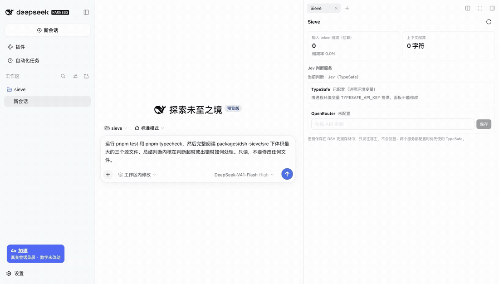
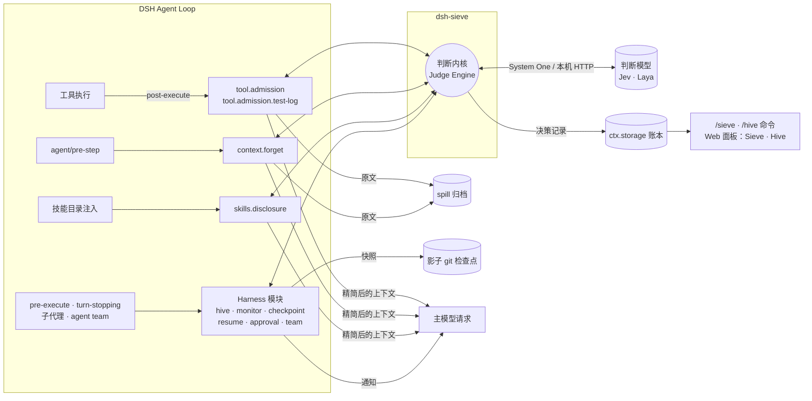
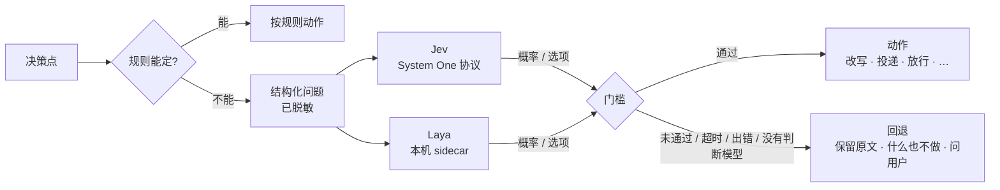

<div align="center">


<p><a href="README.md">English</a> | <strong>简体中文</strong></p>

<h1>sieve / dsh-sieve</h1>

**你的 Agent 在漫长调用中做出无数次决断，绝大部分 Token 却在为死掉的日志与陈旧历史重复买单。<br>sieve 是一张嵌入执行循环的精密筛网：截断上下文通胀，只把决定下一步动作的高纯度信息递给模型。**

面向 DeepSeek Harness（DSH）的上下文精炼、Token 止血与长任务监管引擎

[](LICENSE)
[](tsconfig.base.json)
[](package.json)
[](packages/dsh-sieve/package.json)
[](packages/dsh-sieve/package.json)
<br>


[](#设计约束)
[](#设计约束)

**−36%** 请求载荷（离线回放，100 条轨迹）· **−21%** 主模型输入 token（真实模型，80 次运行）· **约 0.3 秒** 单次判断 · **0** 处 DSH 核心改动

<sub>每个数字怎么测的、说明不了什么：[离线回放](#离线回放结果) · [真实模型实测](#真实模型实测deepseek-flash)。真实模型那组早于当前的 Jev / Laya 配置。</sub>

</div>

<p align="center"></p>
<p align="center"><sub>DSH Web 里的一次真实会话：代理读代码、跑测试时，右侧 <b>Sieve</b> 页实时累加估算的输入 token 缩减，以及从上下文中拿掉的字符数。</sub></p>

sieve 是一个专为 DeepSeek Harness（DSH）打造的高性能插件：过滤工具输出、遗忘陈旧上下文、按需披露技能。每份原始输出在改写前均已无损落盘归档，主模型随时一次 `read` 即可回捞。在同一个判断内核下，还有一组 Harness 模块全程监管长任务，杜绝假完成与死循环。

> [!IMPORTANT]
> sieve 需要一个判断模型：**Jev**（云端，需要 API 密钥）或 **Laya**（本机，macOS Apple Silicon）。它从不借用会话自己的模型。没有判断模型时，省 token 的决策不改动任何内容，Harness 模块只按规则运行。[去配置](#判断模型jev--laya)。

## 为什么需要它

你的 Agent 正在漫长的交互与工具循环中，做出成百上千次关键决断。

但只要看一眼它的真实上下文账单，就会发现一个残酷的现实：真正由你输入的指令和核心代码只占极小一部分，剩余的绝大部分载荷全被无休止的上下文通胀填满：

- **工具输出的海啸**：一次测试跑出 8,000 字符，模型其实只需要那 1 行报错；剩余 200 多行绿色的通过日志，却要在后续几十轮请求里被反复重读、计费；
- **幽灵般的旧历史**：三十步前读过、早已被覆盖重写的文件，像幽灵一样粘在每一个请求里往返；
- **臃肿的技能目录**：会话开局挂载上百条技能描述，97% 从未被唤醒，却从第一轮起就霸占着宝贵的上下文窗口。

这不是小钱，而是致命的信噪比灾难。

输入 Token 随着轮数呈二次方滚雪球；上下文窗口被垃圾撑爆，主模型的注意力被严重稀释，推理速度越来越慢，甚至诱发幻觉与假动作。

**sieve 就是为此而生的精密筛网。**

它不搞破坏性的盲目截断，也不改动 DSH 核心一行代码。在工具结果进入会话前、在历史堆积成负担前，它通过一个轻量级判断模型（约 0.3 秒），把噪音精准滤出、原文无损归档，只留下精纯高信噪比的上下文。

### 实际效果

一次 263 行、有一个失败的 vitest 输出（8,020 字符），经过 sieve 的测试日志规则：

```diff
  RUN  v4.1.8 /work/app

- ✓ src/parser.spec.ts (18 tests) 82ms
-   ✓ parser handles case 1 1ms
-   … 另外 223 行通过的测试 …
+[sieve: omitted 225 lines: passing tests]
  ❯ src/date.spec.ts (8 tests | 1 failed) 61ms
    …
    × date > parses ISO week dates 4ms
  FAIL  src/date.spec.ts > date > parses ISO week dates
  AssertionError: expected '2026-W01-1' to be '2025-12-29'
    …
  Test Files  1 failed | 12 passed (13)
       Tests  1 failed | 222 passed (223)
+[sieve: full output: /var/folders/…/dsh-spill-…/session-…/…-bash.txt]
+Use read with offset/limit, or grep this path to search within it.
```

模型实际收到的只有 1,138 字符，而不是 8,020 字符（**直降 86%**）。

- **逐字节忠实**：留下的每一行都与原文完全一致，失败堆栈、关键 diff 与运行摘要受到严格保护；
- **原文随时可查**：完整日志已先行写入 spill 归档，模型若需排查只需一次 `read` 即可取回；
- **提示缓存零破坏**：改写发生在结果写入会话之前，提示缓存（Prompt Cache）从一开始就只看到干净的精简版本。

### 为什么要专门的判断模型

- **死板规则的硬伤**：固定的正则或启发式脚本遇到未曾收录的输出格式，只能原样放行，起不到过滤效果；
- **让主模型自裁的代价**：让昂贵的主模型来判断“这段内容要不要删”，不仅白白消耗高昂的推理 Token，还要多等一整轮模型往返。

**sieve 的解法：旁路调用专职的小判断模型。**
只抛出高度聚焦的结构化单选题或布尔题，返回校准概率，单次判断中位延迟仅 **约 0.3 秒**。
若置信度未过门槛，或遇到任何网络抖动与超时异常，内核一律执行绝对防御：**原文完整保留**。

### 任务跑深了，问题更致命

当你的 Agent 一跑就是几个小时，光省 Token 已经不够了，长任务里的“假动作”与偏航开始致命冒头：
- 改完代码连跑都没跑，就信誓旦旦声称任务完成；
- 命令跑到一半遭遇宿主崩溃，重启后不知道刚才的写操作能不能安全重放；
- 同一个错误连续循环报错三次，模型还在机械撞墙；
- 多个调查子代理（蜂）各自为战，A 发现的关键线索，B 还在两眼一抹黑重复排查。

sieve 的 Harness 模块共用同一个判断内核：不只给 Token 止血，更充当长任务的冷峻监工与安全副驾。

## 核心能力与适用场景

适用于跑在 DeepSeek Harness 上的 AI 编程智能体，尤其是测试日志长、工具调用频繁、会话多轮或技能目录大的任务。

| 方向 | sieve 的处理方式 |
|---|---|
| **输入 Token 用量优化（Input Token Reduction）** | 在工具结果进入会话前过滤冗余内容，减少后续每轮重复发送的输入 |
| **工具输出过滤（Tool Output Filtering）** | 对构建日志、测试报告与命令输出分级处理，保护失败信息与测试摘要 |
| **上下文压缩与裁剪（Context Compaction / Pruning）** | 批量替换不再相关的历史工具结果，保留归档指针，支持原文回读 |
| **技能按需披露（Progressive Skill Disclosure）** | 按任务相关性展示技能目录，减少无关技能描述占用上下文窗口 |
| **提示缓存感知的上下文管理（Prompt Cache Awareness）** | 新工具结果在写入前处理；历史裁剪按批提交，控制缓存前缀重建频率 |

## 本次更新：Harness 模块

> [!NOTE]
> **未发布。** 在 `main` 分支上，尚未发布到 npm 和 GitHub Release：0.3.0 只有省 token 的决策。想试用请[从源码构建](#方式三从源码构建)；下一次发布之前，包的版本号仍是 0.3.0。

省 Token 只是前半场。面对长周期、深水区的复杂任务，sieve 引入六大 Harness 模块，全由同一个判断内核驱动，专治各种“假动作”与迷航：

| 模块 | 一句话 |
|---|---|
| **Hive** | 问一个问题，2–6 只只读的蜂一起查。发现贴到共享看板，由 judge 决定哪只蜂需要哪条 |
| **长任务监控** | 改完没运行就说做完了？事实不支持就把 goal 标成完成？同一种失败连来三次？它都会发现 |
| **检查点与回退** | 每个回合第一次修改前拍快照；`/sieve rewind` 把文件放回去，并从那个回合 fork 对话 |
| **崩溃恢复** | 命令跑到一半崩了？恢复后告诉模型那条调用能不能重跑 |
| **Jev 审批** | 常规调用不再打扰你，把凭据发往别处的调用直接拒绝，其余照常问你 |
| **团队监工** | 给 DSH agent team 用：释放卡住的成员，重开站不住的任务，拦下落在别人文件里的编辑 |

Hive、检查点和崩溃恢复默认生效。长任务监控和团队监工默认处于新增的 `shadow` 模式，只记录本来会做的事，等你打开；Jev 审批要打开 `approval.enabled` 才启用。详见 [Harness 模块](#harness-模块)。

另外新增：`/sieve checkpoints`、`/sieve rewind`、`/sieve rewind undo` 和 `/hive`（[会话命令](#会话命令)）；Web 面板在 **Sieve** 页旁新增 **Hive** 页，显示每只蜂的状态、实时投递关系图和投递流；`shadow` 模式、15 个新决策 id 和六个配置段（[配置](#配置)）；新的 DSH peer：`dsh-subagent`、`dsh-goal`、`dsh-permission-presets`、`dsh-sandbox-policy`、`dsh-user-approval`，以及可选的 `dsh-experimental-agent-team`，版本都是 `0.2.1-rc.2`。

<details>
<summary>本次修复</summary>

- 账本异步打开存储，打开之前的记录会被丢掉，会话最早的几条记录可能丢失。现在这些记录先放内存（上限 1000 条），存储打开后按顺序写入。
- hive 撞到宿主的子代理上限（`maxActiveSubagents`）时，不再有蜂永远等下去：被拒绝的蜂排队等空位，只在本 hive 还有蜂在运行或启动时才等，取消即返回。
- 团队 verifier 有了时限（`team.verifierMinutes`，默认 10 分钟），sieve 卸载时也会停掉它。
- `/sieve rewind` 先确认对话能分叉，再动文件；文件恢复后分叉仍然失败时，记为一次只回退文件的回退，可以用 `/sieve rewind undo` 撤销，原会话也会收到说明。
- 进程重启后，被恢复的蜂仍能被认出是蜂，再给它发消息时，写文件和派生工具不会回来。

</details>

## 快速开始

1. 安装插件（Web profile 同时装面板）：

   ```bash
   dsh plugin --profile web add dsh-sieve@0.3.0 dsh-sieve-web@0.3.0
   ```

2. 配置判断模型，二选一：
   - **Jev**：在 DSH Web 右侧栏 **Sieve** 页粘贴 TypeSafe 或 OpenRouter 的 API 密钥，或设置环境变量 `TYPESAFE_API_KEY`；
   - **Laya**：在本机启动 Laya 服务，并在 profile 中把 `judge.type` 设为 `laya`，见[使用 Laya](#使用-laya)。
3. 重启 `dsh web` 并刷新页面，在会话中输入 `/sieve status`，确认“判断模型”一行不是“未配置”。

就这些：照常干活，看 **Sieve** 页的数字往上涨。用 `main` 构建的，还可以试试 `/hive <一个关于你代码的问题>`，同时开着 **Hive** 页。其他安装方式见[安装](#安装)。

## 架构



| 组件 | 作用 |
|---|---|
| **判断内核** | 统一的决策引擎：组装题面、调用判断模型、校验结构化输出、按置信度门槛决定是否动作；判断超时或失败一律走安全的回退 |
| **`tool.admission`** | 工具结果写入会话前的准入控制，对长输出分级处理，只改写 `content`，不改工具调用结构 |
| **`tool.admission.test-log`** | 测试运行输出的专用准入通道，保护失败、摘要与无法识别的内容 |
| **`context.forget`** | 批量遗忘较早的工具结果，通过 DSH 原生 `compaction/prune` 与结果替换落地；一批攒够收益才提交，见[缓存问答](#常见问题) |
| **`skills.disclosure`** | 首份技能目录按任务相关性过滤，相关技能在后续回合按需公布；被隐藏的技能仍可直接加载 |
| **Harness 模块** | 监管长任务的六组决策，见 [Harness 模块](#harness-模块) |
| **账本** | 每个会话一份 `ctx.storage` 文档，记录每次判断的结果、用量与预计节省 |
| **`dsh-sieve-web`** | DSH Web 右侧栏。**Sieve** 页显示本会话的输入 token 缩减（估算）与上下文缩减字符数、当前判断模型，并配置 Jev 密钥；**Hive** 页显示本会话的 hive |

## Harness 模块

同一个判断内核也用来监管长任务。每个模块是一组决策，各有默认模式：`active` 会动作，`shadow` 只把本来会做的事记进账本，`off` 什么也不做。

| 模块 | 决策 | 默认 | 作用 |
|---|---|---|---|
| **Hive** | `hive.*`、`swarm.routing` | active | `hive` 工具和 `/hive <问题>` 让 2–6 只只读调查员（“蜂”）一起查一个问题。蜂把发现贴到共享看板；judge 只把一条发现投递给与它相关的蜂，撤下被更正的旧笔记，遇到矛盾时派核验蜂。结果是每只蜂的报告加看板摘要；Web 面板的 Hive 页把投递画成关系图 |
| **长任务监控** | `goal.met`、`turn.completion`、`turn.drift` | shadow | 事实不支持时拦下 `update_goal` 把 goal 标为完成；改了文件却什么都没运行就声称完成时，每回合提醒一次；发现循环、卡住和偏离 goal |
| **检查点与回退** | `turn.rewind` | active | 每个回合第一次修改前，用影子 git 给工作区拍快照（不碰项目自己的 `.git`）。`/sieve rewind` 原地恢复文件，并从那个回合 fork 对话。代理反复失败时 judge 可能建议回退，但从不自动回退 |
| **崩溃恢复** | `resume.safety` | active | 冷恢复后，对会话停下时正在执行的工具调用分类（`read_only`、`idempotent`、`verify_first`、`unsafe`），告诉模型能不能重跑；有检查点时一并给出 |
| **Jev 审批** | `tool.approval`、`tool.risk` | 关闭，打开 `approval.enabled` 才启用 | 接管 DSH 的 **Auto** 权限预设。读取和项目内的编辑直接放行；把凭据发往其他机器的调用一律拒绝；风险规则标记的命令，只有 judge 认定是用户要求的才放行；其余调用只有确定“任务需要”才放行。其他情况，以及判断失败，都转给用户确认 |
| **团队监工** | `team.release`、`team.verify`、`team.conflict`、`team.dispatch` | shadow | 只在装了 DSH agent team 时加载，只以 lead 身份做释放、指派和中断。监控反复发现卡住的成员会被释放（之前先建议一次 hive）；完成但站不住的任务会被重新打开（拿不准时派只读 verifier）；落在他人写入范围里的编辑会被拦下；就绪任务派给空闲成员；崩溃后唤醒或释放中途被打断的 owner |

边界：

- 写入范围只检查写文件的工具，成员仍然可以通过 `bash` 写入。
- Jev 审批和 DSH 的 `auto-review` 插件都提供 Auto 预设，只能装载其中一个。sieve 卸载时，仍在 Auto 的会话切回默认预设。
- 子代理的调用按最近的非子代理会话里用户自己的请求来审批，父模型写的 brief 不作为依据。

### 实战记录：一次真实的 hive

2026-10-31，`dsh web`，三只蜂，主模型 `deepseek-flash`，judge 是 Jev `jev-1.14.0`。问题：hive 怎样决定一条发现的收件蜂，什么限制每只蜂的笔记数？

| 耗时 | 上看板的笔记 | 投递 | 更正 | judge 调用 | judge 费用 | 主模型 |
|---:|---:|---:|---:|---:|---:|---:|
| 346 秒 | 19 | 15 | 2 | 195 次，无失败，中位 248 毫秒 | 约 0.018 美元 | 约 469 万 token，89% 是缓存读，低谷价约 0.12 美元 |

答案里的文件、函数、行号和上限都对。两次更正来自同一只蜂：它先报告最先查的目录里没有这份代码，随后把其他蜂指到正确的仓库。Hive 页全程实时跟随，显示每只蜂的状态、投递关系图和投递流。

### judge 被骗了，会放坏东西过去吗？

Jev 审批在 35 条带标签的调用上离线回放过（15 条该放行、16 条该问、4 条该拒绝），来源是一套现有的权限测试和 `auto-review` 的风险分级，走的是闸门自己的代码，配三种桩 judge。简单说：一个被骗到什么都答“是”的 judge，确实会让 14 条本该问用户的调用放行，但凭据外发和 DSH 设置目录这几条一条也过不去，规则自己就守住了：

| 桩 judge | 误放行 | 省下的 ask（共 32 次） | 拒绝的凭据外发 |
|---|---|---|---|
| 判得对 | 0 | 12 | 4 / 4 |
| 被骗（一律答“需要、用户要求过”） | 14；凭据外发和 DSH 设置目录这 6 条仍由规则守住 | — | 4 / 4 |
| 不回答 | 0 | 2 | 4 / 4 |

用真实 judge（Jev `jev-1.14.0`，2026-10-31，同样 35 条跑三轮）：105 次调用误放行 0；每轮 32 次该问的省掉 11 次；4 条凭据外发全部拒绝；judge 没有失败，单次判断中位 237 毫秒，三轮 judge 费用合计 0.0012 美元。唯一的偏差偏向安全：用户要求的 force-with-lease 推送被转给用户确认，因为 Jev 没有认定用户明确要求过。

## 判断模型（Jev / Laya）

规则能处理的情况由确定性规则直接处理；规则拿不准的部分交给判断模型。决策点把待判断的内容整理成结构化问题（是/否题、单选题），判断模型对每个问题返回概率或选项，内核再按门槛决定动作还是走回退。



| 判断模型 | 说明 | 需要 |
|---|---|---|
| **Jev** | TypeSafe 的结构化判断模型，通过 System One 协议原生回答是/否题和单选题，并返回每个回答的概率。可走 TypeSafe 官方端点或 OpenRouter，按 TypeSafe 计费（[官方价格](https://docs.typesafe.ai/models)） | TypeSafe 或 OpenRouter 的 API 密钥 |
| **Laya** | 开放权重的类型化判断模型（mmBERT-base，322M），在本机 Core ML 上运行，请求不出本机、不收费。窗口只有 1024 token，长状态会被截断；在复杂问题上明显弱于 Jev | macOS Apple Silicon，本机运行 Laya 服务 |

**不用会话模型。** 判断只发给 Jev 或 Laya。sieve 不会把判断题交给当前会话的主模型，也不提供这样的配置项；旧版 profile 中的 `judge.type: llm`、`judge.type: off`、`judge.provider`、`routes` 会在加载时报错。

**没有判断模型时。** 默认的 `judge.type: auto` 在每次决策前查找 Jev 密钥。找不到时，四个省 token 的决策完全不运行，规则也不运行：不折叠、不遗忘、不过滤技能、不写账本，`/sieve status` 和 Web 面板显示“未配置判断模型”。Harness 模块保留规则能处理的部分，本来要问 judge 的地方走回退（`shadow` 下两者都只记账）：

- 照常拍检查点，`/sieve rewind` 照常可用；不再建议回退；
- 打开了 Jev 审批时，读取和项目内的编辑照常放行，凭据外发照常拒绝，动到 DSH 自己目录的调用照常问用户；其余调用都问用户；
- 崩溃恢复照常把只读调用标为可以重跑，其他调用不给建议；
- 长任务监控照常发现循环，并阻塞一直在循环的 goal；完成声明、goal 达成和偏离检查什么也不做；
- hive 照常运行，但没有发现会上看板，蜂各自独立调查；
- 团队监工照常释放监控反复发现卡住的成员，照常拦下落在他人写入范围里的编辑；不做验收，也不派任务。

保存密钥后下一次决策立即生效，不需要重启。

**判断不进入主对话。** 判断调用是旁路请求，不写入会话日志，不进入主模型的上下文，也不改变主模型的请求前缀。发给判断模型的内容会先脱敏：只替换可确定是凭据的内容，包括凭据形态的 token、名称表明是密钥的赋值，以及当前进程凭据变量的值。

**失败一律走回退。** 单次判断有时限（默认 4000 ms），超时、出错或回答不合法时都保留原文（或模块什么也不做，或转给用户确认），原因记入账本。

### 使用 Jev

任选一种方式提供密钥：

- **Web 面板**：右侧栏 **Sieve** 页的「Jev 判断服务」，为 TypeSafe 或 OpenRouter 粘贴密钥并保存。密钥存进 `$DSH_HOME/.credentials.yaml`，只发往宿主，面板不会回显。两个都配置时优先用 TypeSafe。
- **环境变量**：`TYPESAFE_API_KEY` 或 `SIEVE_JUDGE_OPENROUTER_API_KEY`，放在启动 `dsh` 的 shell 环境、启动目录的 `.env` 或 `$DSH_HOME/.env` 中。进程环境变量的优先级高于面板保存的密钥，此时面板只显示来源，不能修改。
- **profile**：`judge.type: system-one`，写明 `apiKey`（建议 `!!js process.env.XXX`），可选 `baseUrl` 与 `model`，见[配置](#配置)。

> [!NOTE]
> 使用默认的 `auto` 时，只要环境里有 `TYPESAFE_API_KEY`（例如 shell 配置文件中的 export，或项目 `.env`），sieve 就会用它调用 Jev 并产生 TypeSafe 费用。

实测（离线回放）：326 次 Jev 请求全部成功，HTTP 延迟 P50 287 ms、P95 590 ms。

### 使用 Laya

Laya 运行在本机，只支持 macOS 15 及以上的 Apple Silicon（Core ML）。sieve 只通过本地 HTTP 连接 Laya 服务，默认地址 `127.0.0.1:47823`；sieve 不自带服务，也不负责安装和启动。搭建一个服务需要三部分：

1. **推理库**：[`laya-coreml`](https://github.com/mizorewww/laya-coreml)（Apache-2.0），[Laya](https://github.com/NandhaKishorM/laya) 的 Core ML 移植，不依赖 PyTorch。用 [uv](https://docs.astral.sh/uv/) 安装：

   ```bash
   uv venv --python 3.12 ~/.laya/.venv
   ```

   ```bash
   uv pip install --python ~/.laya/.venv/bin/python --index-url https://pypi.org/simple laya-coreml==0.1.0
   ```

2. **权重**：Hugging Face 上的检查点 `aac6fef/laya-multilingual-coreml`（mmBERT-base，322M，FP16，约 680 MB）。下载后按包内清单校验：

   ```bash
   ~/.laya/.venv/bin/python - <<'PY'
   import json
   from pathlib import Path
   from huggingface_hub import snapshot_download
   from laya_coreml.artifacts import verify_files

   target = Path.home() / ".laya/models/laya-multilingual-coreml"
   snapshot_download("aac6fef/laya-multilingual-coreml", local_dir=target, allow_patterns=[
       "coreml_config.json", "rl_agent_config.json", "encoder/config.json", "tokenizer/*",
       "model.mlpackage/**", "host_weights.safetensors", "README.md", "LICENSE*", "NOTICE*"])
   files = json.loads((target / "coreml_config.json").read_text())["files"]
   verify_files(target, files)
   print(f"verified {len(files)} files")
   PY
   ```

   在 Python 中，`laya_coreml.load(model_dir, local_files_only=True)` 返回的模型用 `predict(state, questions)` 回答 Laya 自己的题型（`noul`、`choice`、`score`）。

3. **HTTP 服务**：在这个模型外包一层本地服务，实现下面的协议。sieve 不提供服务实现，需要自己编写，或使用任何实现了同一协议的服务。

<details>
<summary>Laya 服务协议</summary>

`POST /evaluate`，`Content-Type: application/json`：

```json
{
  "state": "字符串、对象或数组",
  "questions": {
    "q1": { "type": "boolean", "instructions": "…", "criteria": { "true": "…", "false": "…" } },
    "q2": { "type": "choice", "instructions": "…", "criteria": { "keep": "…", "drop": null } },
    "q3": { "type": "score", "instructions": "…", "criteria": ["low", "mid", "high"] }
  }
}
```

`boolean` 对应 Laya 的 `noul`；`boolean` 题的 `criteria` 可省略，值为 `null` 的描述交给 Laya 时应置空或去掉。成功时返回 HTTP 200：

```json
{
  "answers": {
    "q1": { "type": "boolean", "probability": 0.93 },
    "q2": { "type": "choice", "choice": "keep", "probabilities": { "keep": 0.81, "drop": 0.19 } },
    "q3": { "type": "score", "score": 1.4, "probabilities": { "0": 0.1, "1": 0.4, "2": 0.5 } }
  },
  "usage": { "inputTokens": 980, "outputTokens": 0 },
  "warnings": [{ "type": "state_truncated", "questionId": "q1", "message": "…" }],
  "providerMetadata": { "laya": { "model": "laya:aac6fef/laya-multilingual-coreml", "answers": { "q1": { "confidence": 0.7 } } } }
}
```

- 每道题都必须有同 `type` 的答案，否则 sieve 拒收整个响应。`probability` 是判为 true 的概率；`score` 是 `[0, 档数 - 1]` 内的小数位置。
- `usage`、`warnings`、`providerMetadata` 可选。截断应通过 `warnings` 上报（sieve 会记入账本）；`providerMetadata.laya.model` 是账本里记录的模型名，`confidence` 须在 `[0, 1]` 内，否则忽略。
- 出错时返回 4xx（请求有误）或 5xx（服务故障），响应体为 `{"error": {"message": "…"}}`；两种情况 sieve 都保留原文。
- 协议没有鉴权，只监听本机回环地址。Core ML 模型不能并发调用，请求需串行处理。

</details>

服务运行后，在 profile 中指定：

```yaml
- id: sieve
  config:
    judge:
      type: laya
      # baseUrl: http://127.0.0.1:47823   # 默认值，sidecar 换了端口时再写
```

Laya 服务没有运行时，每次判断都会失败并走回退，账本里记为 `error:unreachable`，规则部分照常运行。

> [!NOTE]
> Laya 的窗口是 1024 token，问题、选项和状态共用；超出部分从状态末尾截掉，并作为告警记入账本。此前的实测显示它在简单谓词上可用，在需要综合判断的问题上接近随机。省 token 的决策和 Harness 模块都还没有在 Laya 上做过效果测量，对判断质量有要求时用 Jev。

## 设计约束

一句话：原文不丢，没有不留记录的动作，DSH 本身一行不改。sieve 的目标是**在不降低任务成功率的前提下**缩减上下文，因此有几条硬约束：

- **原文不丢**：任何有损改写之前，原文先写入 spill 归档，模型可以按需取回。
- **冷恢复一致**：模型可见的内容全部能从会话日志重建。在线请求与会话恢复、fork 之后的请求一致，不会重复判断或重复改写。
- **不写自定义事件**：状态只从 DSH 原生事件推导，账本放在 `ctx.storage`，不会让会话因未知事件而无法恢复。
- **DSH 核心零修改**：只使用公开扩展点（`agent/pre-step`、工具 pre-execute 与 post-execute、`agent/turn-stopping`、技能目录监听、子代理运行时、Auto 权限预设、agent team 服务、`ctx.storage`、`ctx.credentials`、`connection.fetch` 路由）。
- **资源随插件生命周期**：所有监听器、定时器与子代理通过 `ctx` 注册，处处响应 `AbortSignal`，卸载与热重载可完整清理。
- **失败不冒进**：判断模型不可用、输出不合法或超时时，一律保留原文；监管类模块什么也不做（落在他人写入范围里的编辑保持拦下）；Jev 审批转给用户确认。

每条约束都有对应的契约测试，针对固定版本的 DSH 源码验证调用顺序、结果替换、spill 顺序、技能目录过滤与冷恢复行为。

## 离线回放结果

数据来自冻结的公开 Agent 轨迹与原始会话：同一批轨迹分别在四个省 token 决策全部关闭与全部开启下回放并逐条配对，在真实 DSH Loop 与 sieve 监听器上运行，判断模型为真实的 Jev（`jev-1.13.0`），主模型调用为回放。

| 数据集 | 配对数 | 累计请求载荷 | 工具输出 |
|---|---:|---:|---:|
| SWE-smith + Nebius 公开轨迹 | 100 | 537,410,284 → 342,420,598 字符（**−36.28%**） | 11,312,658 → 4,193,084 字符（**−62.93%**） |
| 　其中 SWE-smith | 50 | **−30.88%** | **−50.47%** |
| 　其中 Nebius | 50 | **−37.58%** | **−67.66%** |
| SWE-chat 原始会话 | 7 | 33,733,731 → 18,204,646 字符（**−46.03%**） | 314,263 → 128,407 字符（**−59.14%**） |

**信息保留。** 在 38 个人工标注的工具输出样本上（29 条调优、9 条留出），必需信息保留 **72/72、19/19，零标注误删**。

**正确性。** 222 次回放全部通过工具返回值与错误状态、受保护日志行、原文归档、原生冷恢复和 projection 重建检查；1,422 份归档原文逐字节可取回。

**判断开销。** 共 326 次 Jev 请求，全部成功、零回退；输入 729,167 token、输出 30,868 token。HTTP 延迟 P50 **287 ms**、P95 **590 ms**、最大 1,195 ms，没有一次超过 4 秒（回放使用更长的等待，生产默认的 4 秒时限未在本轮复跑）。

> [!NOTE]
> 载荷与工具输出按请求 JSON 的字符数计，两种口径有重叠，不能相加，也不等于实际 token。离线回放固定了后续动作，不能说明真实执行下的补读次数与任务成功率不变。SWE-chat 回放只覆盖首份技能目录，没有覆盖多轮再披露。

## 真实模型实测（DeepSeek Flash）

2026-10-07 在 deepseek-flash 上做了一次真实主模型的配对实测：固定版本 DSH CLI（0.2.1-alpha.1）在一次性 `DSH_HOME` 中跑 headless 会话，模型自己决定调用哪些工具。4 个任务（测试日志修复、构建报错修复、技能加载、7 轮渐进修改加一道回忆题）× 4 组配置 × 5 次重复，80 次运行全部有效，判定规则在运行前写定。

| 配置 | 主模型输入 token | 未命中 | 输出 | 缓存命中率 |
|---|---:|---:|---:|---:|
| sieve 全关（基线） | 373 万 | 24.8 万 | 6.8 万 | 93.4% |
| 基线再跑一次（噪声参照） | +4.5% | −2.4% | −1.4% | 93.8% |
| **四个决策全开** | **−21.2%** | **−15.3%** | **−6.7%** | 92.9% |
| 全开但关闭遗忘 | −11.6% | −11.5% | −3.5% | 93.3% |

- **token**：全开比基线少约 21%，超出同配置重跑本身的波动（约 4%）。关闭遗忘后只少约 11%，遗忘约占一半。
- **缓存**：开启 sieve 后命中率不变；不计每次运行的首个请求，基线为 96.1%，全开为 96.3%。为什么遗忘改写历史却没有拉低命中率，见[常见问题](#常见问题)。
- **任务结果**：四组配置的代码任务都是 20/20 成功。回忆题上全开配置答错 1 次，原因是模型自己用 `tail -60` 截掉了包含答案的那一行，sieve 没有改动过这段输出；其余配置全对。

> [!NOTE]
> 这次实测时 sieve 还允许用会话模型做判断，运行环境里没有 Jev 密钥，判断由 deepseek-flash 自己完成（17 次调用中 5 次超过 4 秒时限，按规则保留原文）。当前版本已删除这条路径，必须配置 Jev 或 Laya；上表还没有在 Jev 或 Laya 下复测。由于大部分节省来自规则，判断模型的更换主要影响规则拿不准的那部分。另外，实验只覆盖 4 个自建任务和 deepseek-flash，任务成功率接近上限、区分力有限，也没有测冷恢复。当时还没有 Harness 模块。

## 常见问题

### sieve 能降低 LLM 推理成本，还是只省 token？

sieve 减少工具输出、历史结果和技能目录中被反复发送的冗余内容，从而降低主模型输入 token 用量。这里的上下文压缩通过内容筛选、裁剪和归档回读实现，不是修改模型权重或 tokenizer。

输入用量降幅不等于 API 费用降幅。评估净成本需要同时计入主模型的缓存命中与未命中输入、输出 token、Jev 判断费用，以及可能的原文补读；使用 Laya 时还需考虑本机资源开销。现有实验分别报告请求字符数和主模型 token 用量，尚不能据此给出当前版本的端到端净费用降幅。

### 改写历史，不会把提示缓存打爆吗？

不会造成持续的失效。提示缓存按前缀命中：本次请求开头与之前请求相同的那一段走缓存，从第一个不同的字节往后按未命中计。所以要看的是 sieve 有没有改动**已经发送过**的内容。逐项看：

| 来源 | 是否改动已发送的内容 | 对缓存的影响 |
|---|---|---|
| 判断模型调用（Jev / Laya） | 否：旁路请求，发往判断服务，不写会话日志，不进主模型请求 | 无 |
| `tool.admission`、`tool.admission.test-log` | 否：在工具结果**写入会话之前**改写它，改的是追加到末尾的新内容；回指只引用前文，不修改前文 | 无，下一次请求的前缀 = 上一次请求 + 精简后的新结果 |
| `skills.disclosure` | 否：首份目录在**进入会话之前**过滤；后来变得相关的技能作为新消息追加公布 | 无 |
| Harness 模块 | 否：通知、提醒和 hive 报告作为新消息或工具结果追加；蜂在各自的会话里运行 | 无 |
| 系统提示、工具定义 | 否：sieve 不动 | 无 |
| 会话恢复、fork | 否：改写结果已写入会话日志，恢复后按日志重建，逐字节相同，不会重新判断 | 无 |
| `context.forget` | **是**：把较早的大段工具结果换成首尾片段加归档指针 | 每批一次：从第一个被替换的结果往后的部分在这一次请求里重新写入缓存 |

唯一会改写历史的是 `context.forget`。它的设计目标就是把这次重建限制成偶发的一次性开销：

1. **主要动老结果**：规则只遗忘最近 4 步（`keepRecent`）之前、至少 1,500 字符的命令输出，以及已被之后的读取完整覆盖的旧读取；更早的文件读取和较新的结果只有判断模型认定已经用不上时才会被替换；文件被遗忘后又重读，就不再按年龄遗忘它，重读量也会从面板的缩减量中扣除；
2. **攒够才提交**：一批至少能省 1 万字符才落地（`minBatchChars`），不够就等下一批，不会每一步都改一点；
3. **一批只重建一次**：同一批的所有替换在同一个请求之前一次落地，之后的请求又在新前缀上连续命中，而且新前缀更短，此后每一步都少发这部分内容。

例子：会话进行到第 30 步，上下文里有 20 个工具结果。第 31 步之前，结果 3、5、8 被判定可以遗忘，合计可省 2.4 万字符，超过 1 万字符的门槛，于是三处替换同时落地。第 31 步的请求从结果 3 开始与上一步不同，这一段按未命中计一次；第 32 步起，前缀与第 31 步相同，恢复命中，且每一步都比不遗忘时少 2.4 万字符。

实测（deepseek-flash，80 次运行）：缓存命中率基线 93.4%、四个决策全开 92.9%；不计每次运行的首个请求，分别为 96.1% 与 96.3%，差别在噪声以内。

如果不想承担这次重建，可以只关遗忘：

```yaml
- id: sieve
  config:
    modes:
      context.forget: off
```

关闭后其余三个省 token 决策不改动已发送的内容，对缓存前缀没有影响；代价是同一实测中 token 降幅从约 21% 降到约 11%。

### 判断模型的调用会挤占主模型的上下文吗？

不会。判断请求只包含待判断的片段和任务目标（脱敏后），发往 Jev 或 Laya，返回的概率只在 sieve 内部使用，不写入会话，主模型看不到。

## 安装

| 包 | 作用 | 适用 profile |
|---|---|---|
| `dsh-sieve` | 插件本体：判断内核、省 token 决策、Harness 模块、账本、`/sieve` 与 `/hive` 命令 | 任意（`web`、`headless` 等） |
| `dsh-sieve-web` | Web 右侧栏的 **Sieve** 页和 **Hive** 页，依赖同版本的 `dsh-sieve` | 仅 `web` |

**版本对应**：sieve 按 DSH 精确版本声明 peer，宿主在安装和启动时校验，版本不符会拒绝加载。

| sieve | DeepSeek Harness | Node.js |
|---|---|---|
| 未发布（`main`） | `0.2.1-rc.2` | `^22.19.0 \|\| >=24.0.0` |
| `0.3.0` | `0.2.1-rc.2` | `^22.19.0 \|\| >=24.0.0` |
| `0.2.0` | `0.2.1-alpha.1` | `^22.19.0 \|\| >=24.0.0` |

`main` 上的 Harness 模块新增了 peer：`dsh-subagent`、`dsh-goal`、`dsh-permission-presets`、`dsh-sandbox-policy`、`dsh-user-approval`，以及可选的 `dsh-experimental-agent-team`；没有它时团队监工不加载。

### 方式一：npm（推荐）

预构建包，不需要在本机编译，也不需要授权构建脚本。插件本体与 Web 面板一起装：

```bash
dsh plugin --profile web add dsh-sieve@0.3.0 dsh-sieve-web@0.3.0
```

`headless` 等没有 Web 界面的 profile 只装本体：

```bash
dsh plugin --profile headless add dsh-sieve@0.3.0
```

也可以在 DSH Web 侧边栏打开**插件 → 添加插件**，依次输入 `dsh-sieve@0.3.0`、`dsh-sieve-web@0.3.0` 安装，效果与命令行相同。

### 方式二：GitHub Release

npm 不可达或想锁定到构建产物时，直接装 [Release](https://github.com/Sev7eEn7/dsh-sieve/releases) 附带的 tgz，同样是预构建包。发布页附有 `SHA256SUMS` 供校验：

```bash
dsh plugin --profile web add https://github.com/Sev7eEn7/dsh-sieve/releases/download/v0.3.0/dsh-sieve-0.3.0.tgz https://github.com/Sev7eEn7/dsh-sieve/releases/download/v0.3.0/dsh-sieve-web-0.3.0.tgz
```

### 方式三：从源码构建

```bash
git clone https://github.com/Sev7eEn7/dsh-sieve.git && cd dsh-sieve
```

```bash
pnpm install && pnpm release:pack
```

```bash
dsh plugin --profile web add ./release/dsh-sieve-0.3.0.tgz ./release/dsh-sieve-web-0.3.0.tgz
```

`pnpm release:pack` 会构建两个包，检查版本与 peer 一致、产物里没有 `workspace:` 和本机路径，然后把 tgz 和 `SHA256SUMS` 输出到 `release/`。从 `main` 构建的包含未发布的 Harness 模块，但文件名仍是 0.3.0。

> [!NOTE]
> 不支持 `github:Sev7eEn7/dsh-sieve` 这种 git 安装：仓库是 monorepo，git 安装只拿到源码，不带 `lib/` 构建产物。请用上面三种方式之一。

### 启用与验证

1. 配置判断模型（[Jev](#使用-jev) 或 [Laya](#使用-laya)）。
2. 重启 `dsh web`（升级已装版本时必须重启），然后刷新浏览器页面，让面板的前端代码重新加载。
3. 确认已加载：

   ```bash
   dsh --profile web --dump-config
   ```

   输出里应有 `# == dsh-sieve` 和 `# == dsh-sieve-web` 两层。
4. 在会话中输入 `/sieve status`：“判断模型”一行应显示 Jev 或 Laya；显示“未配置”时省 token 的决策不会改动任何内容。Web 右侧栏会出现 **Sieve** 页；从 `main` 构建的还会出现 **Hive** 页。

### 升级与卸载

升级时用新版本号重新 `add`，之后重启：

```bash
dsh plugin --profile web add dsh-sieve@<版本> dsh-sieve-web@<版本>
```

卸载时连同配置层一起移除，先卸面板，再卸本体：

```bash
dsh plugin --profile web remove dsh-sieve-web dsh-sieve
```

## 配置

只用 Jev 时不写配置也可以：judge 为 `auto`，省 token 的决策全部 `active`，Harness 模块按各自的默认模式运行（Jev 审批保持关闭），在凭据存储或环境变量里放好密钥即可。需要调整时在 profile 的 patch 中配置 `sieve` 服务：

```yaml
- id: sieve
  config:
    judge:
      type: auto           # auto | system-one | laya
      timeoutMs: 4000
    modes:
      default: active
      context.forget: off  # 例：只关遗忘
```

| `judge.type` | 说明 |
|---|---|
| `auto`（默认） | 用 DSH 凭据存储或环境变量里的 Jev 密钥（先 `TYPESAFE_API_KEY`，再 `SIEVE_JUDGE_OPENROUTER_API_KEY`）；都没有时省 token 的决策不改动任何内容 |
| `system-one` | 用 profile 指定的 Jev 端点；需要 `apiKey`（建议写 `!!js process.env.XXX`），可选 `baseUrl` 与 `model`（默认 `jev-latest`） |
| `laya` | 用本机 Laya 服务；可选 `baseUrl`（默认 `http://127.0.0.1:47823`），不需要密钥 |

`modes` 为每个决策指定 `active`、`shadow` 或 `off`；`default`（默认 `active`）覆盖未单独列出的决策，但监控类和团队类决策未单独列出时保持 `shadow`，除非 `default` 为 `off`。决策 id：`tool.admission`、`tool.admission.test-log`、`context.forget`、`skills.disclosure`、`hive.publish`、`hive.deliver`、`hive.relate`、`swarm.routing`、`goal.met`、`turn.completion`、`turn.drift`、`turn.rewind`、`resume.safety`、`tool.approval`、`tool.risk`、`team.release`、`team.verify`、`team.conflict`、`team.dispatch`。

Harness 模块各有一段配置：

| 配置段 | 主要设置（默认值） |
|---|---|
| `hive` | `enabled`（true）、`maxBees`（6）、`concurrency`（4）、`lastCall`（true）、`beeMinutes`（10）、`sharing`（`judged`；`broadcast` 不经 judge，所有候选都发布并投递，笔记上限照旧；只用于对照） |
| `monitor` | `enabled`（true）、`every`（每 6 次工具调用检查一次偏离）、`repeats`（3 次相同结果算循环）、`stallLoops`（循环 2 次就把进行中的 goal 标为卡住） |
| `checkpoint` | `enabled`（true）、`root`（由 bundle 补丁设置，为空则关闭检查点）、`keep`（50）、`maxAgeDays`（14）、`maxFileMb`（5）、`propose`（true） |
| `resume` | `enabled`（true） |
| `approval` | `enabled`（false） |
| `team` | `enabled`（true）、`stuckAfter`（2 次监控信号）、`verifier`（true）、`verifierMinutes`（10；到时仍在运行的 verifier 被停止，任务保持原样；0 表示不限） |

其他限制（笔记与投递上限、蜂的卡住计时、检查点大小限制等）及默认值见 [`config.ts`](packages/dsh-sieve/src/runtime/config.ts)。

DSH 会整段替换一行的 `config`，不做合并：profile 若自己写了 `sieve` 这一行，要同时写上 `checkpoint.root: !!js dshHomePath('sieve', 'checkpoints')`，否则检查点关闭。

指定 Jev 端点的例子：

```yaml
- id: sieve
  config:
    judge:
      type: system-one
      apiKey: !!js process.env.MY_JUDGE_KEY
      baseUrl: https://<System One 端点>
      model: jev-latest
```

非法配置（例如未知的决策 id，或已删除的 `llm` 判断配置）在加载时直接报错，不会静默回退。

## 会话命令

```text
/sieve status                          查看当前判断模型、本会话的检查点，以及各决策的模式、记录数、已应用数与预计净节省
/sieve mode <决策 id> <off|shadow|active|reset>   覆盖本会话某个决策的模式；reset 恢复 profile 中的设置
/sieve checkpoints                     列出本会话的检查点
/sieve rewind [序号] [files|conversation|both] [preview|force]   回退到某个检查点（默认最近一个）；preview 只说明会改什么，force 连之后手改过的文件一起回退
/sieve rewind undo                     撤销上一次文件回退
/hive <问题>                            让主模型对一个问题起一个 hive
/hive status                           查看本会话正在运行的 hive（只输入 /hive 也一样）
/hive stop [蜂名]                       让全部或某只蜂收尾：关掉工具，立即交报告
/hive kill [蜂名]                       停止全部或某只蜂；它们已有的报告照常交回
```

命令不调用模型，模式覆盖只在当前会话、本次插件装载期间有效。

## 开发

```bash
pnpm install
```

```bash
pnpm build
```

```bash
pnpm typecheck && pnpm test
```

- `pnpm build` 编译两个包，并把 Web 面板的浏览器端打成 DSH Web 可加载的单文件。
- 测试不需要任何密钥：主模型用脚本化适配器，判断模型用进程内的 Laya 协议桩，它只应答发往自己 origin 的 `fetch`，不开 socket。
- `pnpm smoke:package` 把打好的 tgz 装进 `.dsh-test-home/` 下的一次性 profile，启动 web profile 并探测面板接口，最后卸载；不碰真实的 `DSH_HOME`，不调用模型，不进 `pnpm test`。
- `pnpm release:pack` 构建并打包出可安装的 tgz 与 `SHA256SUMS`，见[安装](#方式三从源码构建)。
- 实测脚本，都不进 `pnpm test`：`pnpm measure:approval` 用真实 Jev 回放带标签的审批调用（需要 `TYPESAFE_API_KEY`，只花 judge 费用）；`pnpm measure:hive` 跑 hive 消融实验（`--estimate`、`--preflight` 不花钱，`--execute` 花主模型和 Jev 费用，需要 `--approved-usd`）；`pnpm measure:shadow` 从账本统计 shadow 决策的精度，不调用模型。
- 依赖全部锁定精确版本；`@deepseek-ai/dsh-*` 以精确版本声明为 peer，宿主在安装与启动时校验。

```
packages/
├── dsh-sieve/          # 插件本体：判断内核、省 token 决策、Harness 模块、账本、命令
│   ├── src/judge/      # 决策引擎、Jev 与 Laya provider、各决策（题面与 policy）、脱敏
│   ├── src/features/   # 各决策点与 DSH 扩展点的接线；每个 Harness 模块一个目录
│   └── src/runtime/    # 配置、会话状态推导、账本、检查点存储、状态快照
└── dsh-sieve-web/      # DSH Web 面板：Sieve 页与 Hive 页（Host 路由 + 浏览器端）
```

## 致谢与许可

本项目部分设计与代码移植自 [mu](https://github.com/qybaihe/mu)（MIT 许可），第三方版权声明与许可原文见 [THIRD_PARTY_NOTICES.md](packages/dsh-sieve/THIRD_PARTY_NOTICES.md)。

本项目以 [MIT](LICENSE) 许可发布。
